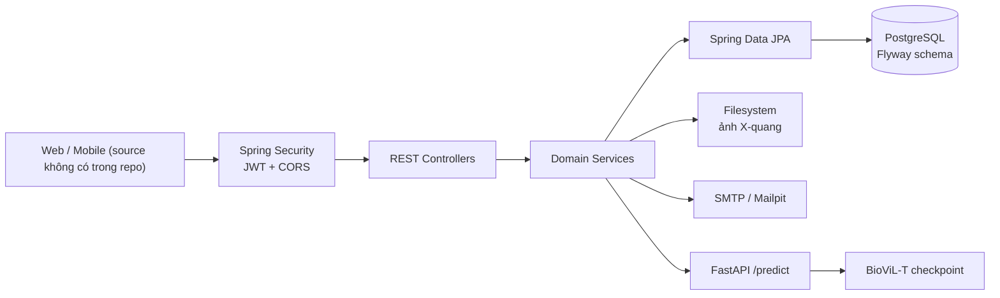
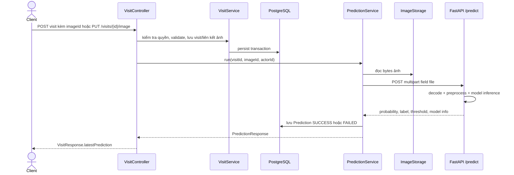

# Báo cáo phân tích Backend SilicoCare

- **Ngày khảo sát:** 09/11/2026
- **Phạm vi:** repository `silicosis-backend`, gồm Spring Boot backend, migration, test và service FastAPI nằm trong `predict/`.
- **Trạng thái thay đổi:** chỉ đọc source; báo cáo này không yêu cầu thay đổi code.
- **Java:** `pom.xml` đặt `java.version=25`; đây là cấu hình build, không tự xác nhận mọi môi trường triển khai đang chạy Java 25.

> Không đọc nội dung `.env` và không đưa thông tin bí mật vào báo cáo. Không tìm thấy mã nguồn web Next.js hoặc React Native trong repository này; do đó không thể xác nhận nơi frontend gọi endpoint.

## 1. Bản đồ source code

```text
silicosis-backend/
├── src/main/java/com/sillicosis/backend/
│   ├── BackendApplication.java
│   ├── auth/                 Xác thực, token, khôi phục mật khẩu
│   │   └── dto/
│   ├── common/               Lỗi API, validation, tiện ích dùng chung
│   ├── config/               Spring Security, cấu hình ứng dụng, OpenAPI, Clock
│   ├── image/                Xử lý upload, metadata và lưu file ảnh
│   │   └── dto/
│   ├── mail/                 Gửi email OTP
│   ├── patient/              Hồ sơ bệnh nhân, quyền truy cập, đồng bộ hồ sơ
│   │   └── dto/
│   ├── prediction/           Gọi FastAPI và lưu kết quả dự đoán
│   │   └── dto/
│   ├── user/                 Tài khoản hiện tại và chức năng admin
│   │   └── dto/
│   └── visit/                Lượt khám và dữ liệu lâm sàng
│       └── dto/
├── src/main/resources/
│   ├── application.yaml
│   └── db/migration/         V1__init_auth.sql, V2__predictions.sql
├── src/test/java/            Unit tests và integration tests Java
├── src/test/resources/       application-test.yaml
├── predict/
│   ├── app/                  FastAPI, model, preprocessing, schema, lỗi
│   └── tests/                Kiểm thử API và xử lý ảnh Python
├── docs/                     Tài liệu API
├── docker-compose.yml        PostgreSQL và Mailpit cho phát triển
├── pom.xml                   Maven, dependencies, phiên bản Java
└── mvnw, mvnw.cmd            Maven Wrapper
```

### Các layer

Backend dùng cấu trúc theo domain và phân lớp:

1. **Controller:** nhận HTTP request, bind DTO/path/query/header, validation, trả HTTP status.
2. **Service:** nghiệp vụ, phân quyền theo đối tượng, transaction, phối hợp các repository và dịch vụ ngoài.
3. **Repository:** Spring Data JPA, query method, JPQL/native SQL.
4. **Entity:** ánh xạ bảng và cột PostgreSQL.
5. **DTO:** request/response riêng, tránh trả trực tiếp entity.
6. **Config/common:** cấu hình bảo mật, properties, exception mapping, validation và tiện ích.

Một số FK được giữ dưới dạng UUID thay vì JPA relationship (ví dụ `Image.ownerId`, `Visit.patientId`, `Prediction.visitId`). Vì vậy service tự truy vấn và kiểm tra một số quan hệ/quyền.

## 2. Danh mục file và trách nhiệm

### 2.1 Application, cấu hình và xử lý lỗi

| File | Vai trò và hành vi |
|---|---|
| [BackendApplication.java](../src/main/java/com/sillicosis/backend/BackendApplication.java) | `@SpringBootApplication`, `@ConfigurationPropertiesScan`, `@EnableAsync`; `main` khởi động Spring. |
| [config/SecurityConfig.java](../src/main/java/com/sillicosis/backend/config/SecurityConfig.java) | Tạo `SecurityFilterChain`, BCrypt, JWT encoder/decoder HS256, chuyển claim `role` thành `ROLE_*`, cấu hình CORS và stateless session. Public: `/api/auth/**`, tài liệu OpenAPI/Swagger, `/error`; các request khác cần authenticated. |
| [config/AppProperties.java](../src/main/java/com/sillicosis/backend/config/AppProperties.java) | Record properties `app.*`: JWT, lockout, OTP, mail, admin, CORS, storage, patient, visit, predict. Có default TTL và giới hạn. |
| [config/ClockConfig.java](../src/main/java/com/sillicosis/backend/config/ClockConfig.java) | Cung cấp `Clock.systemUTC()` cho service và kiểm thử thời gian. |
| [config/DelegatingErrorHandlers.java](../src/main/java/com/sillicosis/backend/config/DelegatingErrorHandlers.java) | Chuyển lỗi authentication/authorization từ security filter tới Spring `HandlerExceptionResolver`. |
| [config/OpenApiConfig.java](../src/main/java/com/sillicosis/backend/config/OpenApiConfig.java) | Metadata OpenAPI `SilicoCare API`, version `v1`, scheme HTTP bearer JWT. |
| [common/GlobalExceptionHandler.java](../src/main/java/com/sillicosis/backend/common/GlobalExceptionHandler.java) | `@RestControllerAdvice`: ánh xạ lỗi nghiệp vụ, validation, malformed request, upload quá cỡ, unique conflict, auth/permission và lỗi không dự kiến thành JSON. Không ghi request body vào log. |
| [common/ApiError.java](../src/main/java/com/sillicosis/backend/common/ApiError.java) | Response lỗi gồm `timestamp`, `status`, `code`, `message`, `path`, tùy chọn `fieldErrors`/`details`. |
| [common/ApiException.java](../src/main/java/com/sillicosis/backend/common/ApiException.java) | Exception nghiệp vụ mang `HttpStatus`, code ổn định, message và details; factory cho các status thường dùng. |
| [common/InvalidFieldsException.java](../src/main/java/com/sillicosis/backend/common/InvalidFieldsException.java) | Lỗi field validation phát hiện trong service; handler trả 400 `VALIDATION_FAILED`. |
| [common/PageResponse.java](../src/main/java/com/sillicosis/backend/common/PageResponse.java) | Chuyển `Page<E>` thành `{content,page,size,totalElements,totalPages}` với mapper DTO. |
| [common/MessageResponse.java](../src/main/java/com/sillicosis/backend/common/MessageResponse.java) | DTO `{message}` dùng trong API. |
| [common/PhoneNumbers.java](../src/main/java/com/sillicosis/backend/common/PhoneNumbers.java) | Chuẩn hóa `+84`/`84`/`0`, loại dấu phân cách, kiểm tra số di động Việt Nam. |
| [common/VnPhone.java](../src/main/java/com/sillicosis/backend/common/VnPhone.java) | Annotation Bean Validation; chuỗi rỗng được chấp nhận để phone là tùy chọn. |
| [common/StrongPassword.java](../src/main/java/com/sillicosis/backend/common/StrongPassword.java) | Constraint 8–72 ký tự, ít nhất một chữ và một số; 72 là giới hạn BCrypt. |
| [common/TokenHasher.java](../src/main/java/com/sillicosis/backend/common/TokenHasher.java) | Sinh token 256-bit base64url, OTP 6 chữ số và SHA-256 hash. |

### 2.2 Auth, token và email

| File | Vai trò và phụ thuộc |
|---|---|
| [auth/AuthController.java](../src/main/java/com/sillicosis/backend/auth/AuthController.java) | Base `/api/auth`; khai báo register, login, refresh, logout, forgot-password, verify-otp, reset-password. Bind DTO và gọi `AuthService`/`PasswordResetService`. |
| [auth/AuthService.java](../src/main/java/com/sillicosis/backend/auth/AuthService.java) | Đăng ký USER và tạo patient cùng transaction; đăng nhập email/SĐT; lockout; refresh rotation; logout. Dùng `UserAccounts`, `UserRepository`, `PatientService`, BCrypt, token service và properties. |
| [auth/TokenService.java](../src/main/java/com/sillicosis/backend/auth/TokenService.java) | Cấp access JWT có `iss`, `sub`, `iat`, `exp`, `jti`, `role`; lưu SHA-256 refresh token; thu hồi toàn bộ refresh session theo user. |
| [auth/RefreshToken.java](../src/main/java/com/sillicosis/backend/auth/RefreshToken.java) | Entity `refresh_tokens`, liên kết `ManyToOne User`, hash, expiry, revoked time; `isActiveAt`. |
| [auth/RefreshTokenRepository.java](../src/main/java/com/sillicosis/backend/auth/RefreshTokenRepository.java) | Tìm bằng hash; bulk update thu hồi token của user. |
| [auth/PasswordResetService.java](../src/main/java/com/sillicosis/backend/auth/PasswordResetService.java) | Sinh/lưu OTP hash, resend cooldown, verify OTP, tạo reset token hash, reset mật khẩu và thu hồi phiên. Phát `OtpMailRequested`. |
| [auth/PasswordResetOtp.java](../src/main/java/com/sillicosis/backend/auth/PasswordResetOtp.java) | Entity `password_reset_otp`: OTP hash, expiry, attempts, used, reset token hash/expiry. |
| [auth/PasswordResetOtpRepository.java](../src/main/java/com/sillicosis/backend/auth/PasswordResetOtpRepository.java) | Lấy OTP mới nhất, tìm reset token hash và vô hiệu hóa OTP/token của user. |
| [mail/OtpMailRequested.java](../src/main/java/com/sillicosis/backend/mail/OtpMailRequested.java) | Application event giữ email/tên/OTP/TTL trong bộ nhớ; `toString()` không hiển thị giá trị. |
| [mail/MailService.java](../src/main/java/com/sillicosis/backend/mail/MailService.java) | `@Async`, `@TransactionalEventListener(AFTER_COMMIT)`: gửi email HTML tiếng Việt. Log kết quả mà không log địa chỉ/OTP; lỗi SMTP chỉ ghi class exception và nguyên nhân. |

DTO auth:

| File | Input/output |
|---|---|
| [RegisterRequest.java](../src/main/java/com/sillicosis/backend/auth/dto/RegisterRequest.java) | `fullName`, `email`, `phone?`, `password`; validation name/email/phone/password. |
| [LoginRequest.java](../src/main/java/com/sillicosis/backend/auth/dto/LoginRequest.java) | `identifier`, `password`; identifier có thể là email hoặc số điện thoại. |
| [RefreshTokenRequest.java](../src/main/java/com/sillicosis/backend/auth/dto/RefreshTokenRequest.java) | `refreshToken`. |
| [ForgotPasswordRequest.java](../src/main/java/com/sillicosis/backend/auth/dto/ForgotPasswordRequest.java) | `email`. |
| [VerifyOtpRequest.java](../src/main/java/com/sillicosis/backend/auth/dto/VerifyOtpRequest.java) | `email`, OTP 6 chữ số. |
| [VerifyOtpResponse.java](../src/main/java/com/sillicosis/backend/auth/dto/VerifyOtpResponse.java) | `resetToken`, `expiresIn` giây. |
| [ResetPasswordRequest.java](../src/main/java/com/sillicosis/backend/auth/dto/ResetPasswordRequest.java) | `resetToken`, `newPassword`. |
| [AuthResponse.java](../src/main/java/com/sillicosis/backend/auth/dto/AuthResponse.java) | Access/refresh token, type, TTL và `UserResponse`. DTO nhạy cảm ghi đè `toString()`. |

### 2.3 User

| File | Vai trò và hành vi |
|---|---|
| [user/User.java](../src/main/java/com/sillicosis/backend/user/User.java) | Entity `users`: UUID, email/phone, password hash, role, enabled, thông tin hồ sơ, đếm login sai/lock, soft-delete và timestamps. Không có `toString()`. |
| [user/UserRepository.java](../src/main/java/com/sillicosis/backend/user/UserRepository.java) | Spring Data JPA + specification executor; truy vấn/kiểm tra trùng email/SĐT và id chỉ xét user chưa soft-delete. |
| [user/UserAccounts.java](../src/main/java/com/sillicosis/backend/user/UserAccounts.java) | Chuẩn hóa email, lookup theo email/SĐT, lấy user hoạt động, bảo đảm email/phone duy nhất. |
| [user/Role.java](../src/main/java/com/sillicosis/backend/user/Role.java) | Enum chỉ có `USER`, `ADMIN`. |
| [user/Gender.java](../src/main/java/com/sillicosis/backend/user/Gender.java) | Enum `MALE`, `FEMALE`, `OTHER`. |
| [user/UserController.java](../src/main/java/com/sillicosis/backend/user/UserController.java) | `/api/users/me`: đọc/cập nhật user hiện tại và đổi password; lấy UUID từ JWT subject. |
| [user/AdminUserController.java](../src/main/java/com/sillicosis/backend/user/AdminUserController.java) | `/api/users`, class-level `@PreAuthorize("hasRole('ADMIN')")`; list/get/create/status/delete. Không có handler đổi role. |
| [user/UserService.java](../src/main/java/com/sillicosis/backend/user/UserService.java) | Profile, password change, admin list/create/lock/delete. Đồng bộ 4 trường hồ sơ user↔patient. Xóa user là soft-delete và thu hồi refresh token. |
| [user/AdminSeeder.java](../src/main/java/com/sillicosis/backend/user/AdminSeeder.java) | `ApplicationRunner`: tạo admin từ `app.admin.*` nếu có email/password và email chưa tồn tại. Kiểm tra password ở đây chỉ là độ dài tối thiểu 8. |

DTO user:

| File | Nội dung |
|---|---|
| [UserResponse.java](../src/main/java/com/sillicosis/backend/user/dto/UserResponse.java) | Thông tin tài khoản và timestamps; không trả password hash. |
| [CreateUserRequest.java](../src/main/java/com/sillicosis/backend/user/dto/CreateUserRequest.java) | Tên, email, phone tùy chọn, password; admin-created user vẫn được gán `USER`. |
| [UpdateProfileRequest.java](../src/main/java/com/sillicosis/backend/user/dto/UpdateProfileRequest.java) | Tên/email bắt buộc; phone, birth date, gender, occupation tùy chọn. |
| [ChangePasswordRequest.java](../src/main/java/com/sillicosis/backend/user/dto/ChangePasswordRequest.java) | `currentPassword`, `newPassword`. |
| [UpdateStatusRequest.java](../src/main/java/com/sillicosis/backend/user/dto/UpdateStatusRequest.java) | `enabled` bắt buộc. |

### 2.4 Patient

| File | Vai trò và hành vi |
|---|---|
| [patient/Patient.java](../src/main/java/com/sillicosis/backend/patient/Patient.java) | Entity `patients`: UUID, mã `BN-*`, userId nullable, thông tin hồ sơ/nghề nghiệp, tiền sử phơi nhiễm/yếu tố nguy cơ, soft-delete và timestamps. |
| [patient/PatientRepository.java](../src/main/java/com/sillicosis/backend/patient/PatientRepository.java) | Truy vấn hồ sơ chưa xóa theo id/userId, truy vấn sequence mã bệnh nhân. |
| [patient/PatientService.java](../src/main/java/com/sillicosis/backend/patient/PatientService.java) | Tạo hồ sơ cho user hoặc admin, đồng bộ dữ liệu, CRUD/soft-delete, xác định quyền chủ sở hữu/admin, filter tìm kiếm không dấu tiếng Việt và validation theo cấu hình. |
| [patient/PatientController.java](../src/main/java/com/sillicosis/backend/patient/PatientController.java) | `/api/patients`: me, admin list/create/delete, chủ hồ sơ/admin get/update. Quyền xem không hợp lệ trả 404. |
| [PatientRequest.java](../src/main/java/com/sillicosis/backend/patient/dto/PatientRequest.java) | Body ghi đè hồ sơ: tên, ngày sinh, giới tính, phone, nghề nghiệp, nơi làm việc, exposure history, risk factors. |
| [PatientResponse.java](../src/main/java/com/sillicosis/backend/patient/dto/PatientResponse.java) | Metadata/hồ sơ trả về; mapper từ entity. |

### 2.5 Image

| File | Vai trò và hành vi |
|---|---|
| [image/Image.java](../src/main/java/com/sillicosis/backend/image/Image.java) | Entity `images`, owner/storage key/type/size/dimensions/SHA-256/visitId/soft-delete. |
| [image/ImageRepository.java](../src/main/java/com/sillicosis/backend/image/ImageRepository.java) | Query ảnh đang hoạt động theo id, owner+hash, owner, visit hoặc danh sách visit. |
| [image/ImageController.java](../src/main/java/com/sillicosis/backend/image/ImageController.java) | `/api/images`: multipart upload, list, metadata, nội dung nhị phân, delete. |
| [image/ImageService.java](../src/main/java/com/sillicosis/backend/image/ImageService.java) | Kiểm tra user active/quyền, xử lý file, duplicate, phối hợp DB và filesystem. Người ngoài chủ ảnh không được xác nhận sự tồn tại (404). |
| [image/ImageProcessor.java](../src/main/java/com/sillicosis/backend/image/ImageProcessor.java) | Validate magic bytes PNG/JPEG, giới hạn bytes/dimensions/cạnh ngắn, decode và re-encode để loại metadata, hash ảnh sau xử lý. |
| [image/ImageStorage.java](../src/main/java/com/sillicosis/backend/image/ImageStorage.java) | Lưu UUID filename vào filesystem, đọc/xóa file; xác thực storage key là UUID trước khi resolve path. |
| [ImageResponse.java](../src/main/java/com/sillicosis/backend/image/dto/ImageResponse.java) | Trả id, content type, size, dimensions, visitId, createdAt; không trả storage key/hash. |

### 2.6 Visit và prediction

| File | Vai trò và hành vi |
|---|---|
| [visit/Visit.java](../src/main/java/com/sillicosis/backend/visit/Visit.java) | Entity `visits`; lưu patientId, visitDate, nghề nghiệp/thâm niên, sinh hiệu, hút thuốc, FVC/FEV1, `extra` JSONB, schemaVersion và timestamps. |
| [visit/VisitRepository.java](../src/main/java/com/sillicosis/backend/visit/VisitRepository.java) | Tìm visit chưa xóa; phân trang theo patient; query admin chỉ lấy visit và patient chưa xóa. |
| [visit/VisitService.java](../src/main/java/com/sillicosis/backend/visit/VisitService.java) | CRUD visit, kiểm tra quyền qua patient, validate liên trường/JSON `extra`, attach/detach ảnh, tính tuổi/BMI khi trả response. |
| [visit/VisitController.java](../src/main/java/com/sillicosis/backend/visit/VisitController.java) | `/api/patients/{patientId}/visits` và `/api/visits`; tạo/sửa/xóa/list, attach/detach ảnh, chạy prediction. |
| [VisitRequest.java](../src/main/java/com/sillicosis/backend/visit/dto/VisitRequest.java) | Các trường ngày, nghề, sinh hiệu, FVC/FEV1, JSON `extra`, `imageId` (chỉ có tác dụng lúc tạo). |
| [VisitResponse.java](../src/main/java/com/sillicosis/backend/visit/dto/VisitResponse.java) | Visit + summary patient, tuổi/BMI tính động, ảnh đã gắn, prediction mới nhất. |
| [AttachImageRequest.java](../src/main/java/com/sillicosis/backend/visit/dto/AttachImageRequest.java) | Body `{imageId}` cho attach image. |
| [prediction/PredictClient.java](../src/main/java/com/sillicosis/backend/prediction/PredictClient.java) | Gửi multipart `file` tới FastAPI `/predict` bằng Spring `RestClient`, HTTP/1.1; map/kiểm tra response, timeout và lỗi. |
| [prediction/PredictionService.java](../src/main/java/com/sillicosis/backend/prediction/PredictionService.java) | Đọc ảnh, gọi client ngoài transaction dài, lưu SUCCESS hoặc FAILED, lấy latest của ảnh đang gắn. Log id/status/error code/thời gian, không log kết quả y tế. |
| [prediction/Prediction.java](../src/main/java/com/sillicosis/backend/prediction/Prediction.java) | Entity `predictions`, lưu mỗi lần chạy, trạng thái/kết quả/model/error code. |
| [prediction/PredictionRepository.java](../src/main/java/com/sillicosis/backend/prediction/PredictionRepository.java) | Native PostgreSQL `DISTINCT ON` để lấy prediction mới nhất theo visit cho ảnh hiện đang gắn. |
| [prediction/PredictionStatus.java](../src/main/java/com/sillicosis/backend/prediction/PredictionStatus.java) | Enum `SUCCESS`, `FAILED`. |
| [prediction/PredictException.java](../src/main/java/com/sillicosis/backend/prediction/PredictException.java) | Exception nội bộ với mã `PREDICT_UNAVAILABLE`, `PREDICT_TIMEOUT`, `PREDICT_BAD_RESPONSE`, `PREDICT_IMAGE_REJECTED`, `PREDICT_IMAGE_UNREADABLE`. |
| [PredictionResponse.java](../src/main/java/com/sillicosis/backend/prediction/dto/PredictionResponse.java) | DTO prediction, trạng thái, kết quả/model/error và disclaimer thử nghiệm. |

### 2.7 Cấu hình/migration và file kiểm thử

- [pom.xml](../pom.xml): Spring Boot parent `4.1.1`, Java 25, Spring Data JPA, validation, Web MVC, Security, OAuth2 Resource Server/JWT, Mail, springdoc `3.1.1`, Flyway/PostgreSQL, Lombok. Test dùng starter test của Boot, Testcontainers PostgreSQL và GreenMail.
- [application.yaml](../src/main/resources/application.yaml): PostgreSQL qua `DB_URL`, `DB_USER`, `DB_PASSWORD`; Hibernate `validate`; Flyway bật; SMTP env; limits multipart; các cấu hình `app.*`; FastAPI mặc định localhost:8001.
- [V1__init_auth.sql](../src/main/resources/db/migration/V1__init_auth.sql): tạo `users`, refresh/OTP tables, images, patients, visits, sequence/index/FK/check constraints.
- [V2__predictions.sql](../src/main/resources/db/migration/V2__predictions.sql): tạo bảng predictions, ràng buộc status/result và index.
- [docker-compose.yml](../docker-compose.yml): PostgreSQL 17 Alpine và Mailpit; cấu hình tài khoản DB lấy từ env.
- [application-test.yaml](../src/test/resources/application-test.yaml): test JWT secret giả, admin seed tắt, dự đoán mặc định tắt và SMTP auth/TLS tắt.
- [TestcontainersConfiguration.java](../src/test/java/com/sillicosis/backend/TestcontainersConfiguration.java): PostgreSQL Testcontainers `postgres:17-alpine`.
- [AuthFlowIntegrationTest.java](../src/test/java/com/sillicosis/backend/AuthFlowIntegrationTest.java): luồng register/login/forgot/verify/reset với DB test và GreenMail; dữ liệu giả.
- [PredictionApiIntegrationTest.java](../src/test/java/com/sillicosis/backend/prediction/PredictionApiIntegrationTest.java): PostgreSQL và HTTP server giả cho FastAPI; kiểm tra multipart, thành công, lỗi, timeout và liên kết prediction.
- [ImageApiIntegrationTest.java](../src/test/java/com/sillicosis/backend/image/ImageApiIntegrationTest.java), [VisitApiIntegrationTest.java](../src/test/java/com/sillicosis/backend/visit/VisitApiIntegrationTest.java), [PatientApiIntegrationTest.java](../src/test/java/com/sillicosis/backend/patient/PatientApiIntegrationTest.java): integration tests API bằng dữ liệu kiểm thử giả.
- Các unit test còn lại: `AuthServiceTest`, `PasswordResetServiceTest`, `PhoneNumbersTest`, `ImageProcessorTest`, `ImageServiceTest`, `PatientServiceTest`, `UserServiceTest`, `VisitServiceTest`, và `BackendApplicationTests`.

## 3. API và Endpoint

Base URL dev theo tài liệu: `http://localhost:8080`. Tất cả endpoint ngoài `/api/auth/**` yêu cầu access JWT trừ khi có ghi khác. Sai validation thường trả 400 `VALIDATION_FAILED`; lỗi JSON/type/query không hợp lệ trả 400 `BAD_REQUEST`; lỗi nghiệp vụ dùng `ApiException`; 401/403 từ security được chuyển qua cùng handler JSON.

| Method | Endpoint | Controller | Service | Chức năng | Frontend sử dụng |
|---|---|---|---|---|---|
| POST | `/api/auth/register` | `AuthController.register` | `AuthService.register` | Tạo USER + patient, cấp cặp token; 201 | Chưa xác định được nơi gọi trong Frontend |
| POST | `/api/auth/login` | `AuthController.login` | `AuthService.login` | Đăng nhập email/SĐT; 200 | Chưa xác định được nơi gọi trong Frontend |
| POST | `/api/auth/refresh` | `AuthController.refresh` | `AuthService.refresh` | Rotation refresh token; 200 | Chưa xác định được nơi gọi trong Frontend |
| POST | `/api/auth/logout` | `AuthController.logout` | `AuthService.logout` | Thu hồi refresh token; 204 | Chưa xác định được nơi gọi trong Frontend |
| POST | `/api/auth/forgot-password` | `AuthController.forgotPassword` | `PasswordResetService.requestOtp` | Yêu cầu OTP; 202, response chung | Chưa xác định được nơi gọi trong Frontend |
| POST | `/api/auth/verify-otp` | `AuthController.verifyOtp` | `PasswordResetService.verifyOtp` | Xác minh OTP, trả reset token; 200 | Chưa xác định được nơi gọi trong Frontend |
| POST | `/api/auth/reset-password` | `AuthController.resetPassword` | `PasswordResetService.resetPassword` | Đổi password bằng reset token; 200 | Chưa xác định được nơi gọi trong Frontend |
| GET | `/api/users/me` | `UserController.me` | `UserService.getMe` | Lấy tài khoản hiện tại; 200 | Chưa xác định được nơi gọi trong Frontend |
| PUT | `/api/users/me` | `UserController.updateMe` | `UserService.updateMe` | Ghi đè thông tin hiện tại; 200 | Chưa xác định được nơi gọi trong Frontend |
| PUT | `/api/users/me/password` | `UserController.changePassword` | `UserService.changePassword` | Đổi password, thu hồi refresh; 204 | Chưa xác định được nơi gọi trong Frontend |
| GET | `/api/users` | `AdminUserController.list` | `UserService.list` | Admin list/filter/page; 200 | Chưa xác định được nơi gọi trong Frontend |
| GET | `/api/users/{id}` | `AdminUserController.get` | `UserService.get` | Admin xem user; 200 | Chưa xác định được nơi gọi trong Frontend |
| POST | `/api/users` | `AdminUserController.create` | `UserService.create` | Admin tạo USER + patient; 201 + Location | Chưa xác định được nơi gọi trong Frontend |
| PATCH | `/api/users/{id}/status` | `AdminUserController.updateStatus` | `UserService.updateStatus` | Khóa/mở tài khoản; 200 | Chưa xác định được nơi gọi trong Frontend |
| DELETE | `/api/users/{id}` | `AdminUserController.delete` | `UserService.delete` | Soft-delete user; 204 | Chưa xác định được nơi gọi trong Frontend |
| GET | `/api/patients/me` | `PatientController.me` | `PatientService.getMine` | Hồ sơ của user hiện tại; 200 | Chưa xác định được nơi gọi trong Frontend |
| GET | `/api/patients` | `PatientController.list` | `PatientService.list` | Admin list/tìm kiếm; 200 | Chưa xác định được nơi gọi trong Frontend |
| POST | `/api/patients` | `PatientController.create` | `PatientService.create` | Admin tạo hồ sơ không gắn user; 201 + Location | Chưa xác định được nơi gọi trong Frontend |
| GET | `/api/patients/{id}` | `PatientController.get` | `PatientService.get` | Admin/chủ hồ sơ xem; 200 | Chưa xác định được nơi gọi trong Frontend |
| PUT | `/api/patients/{id}` | `PatientController.update` | `PatientService.update` | Ghi đè hồ sơ; 200 | Chưa xác định được nơi gọi trong Frontend |
| DELETE | `/api/patients/{id}` | `PatientController.delete` | `PatientService.delete` | Admin soft-delete; 204 | Chưa xác định được nơi gọi trong Frontend |
| POST | `/api/images` | `ImageController.upload` | `ImageService.upload` | Upload multipart PNG/JPEG; 201 | Chưa xác định được nơi gọi trong Frontend |
| GET | `/api/images` | `ImageController.list` | `ImageService.list` | List ảnh của user, phân trang; 200 | Chưa xác định được nơi gọi trong Frontend |
| GET | `/api/images/{id}` | `ImageController.get` | `ImageService.get` | Metadata ảnh; chủ/admin; 200 | Chưa xác định được nơi gọi trong Frontend |
| GET | `/api/images/{id}/content` | `ImageController.content` | `ImageService.content` | Nội dung ảnh nhị phân; chủ/admin; 200 | Chưa xác định được nơi gọi trong Frontend |
| DELETE | `/api/images/{id}` | `ImageController.delete` | `ImageService.delete` | Soft-delete metadata và xóa file; 204 | Chưa xác định được nơi gọi trong Frontend |
| POST | `/api/patients/{patientId}/visits` | `VisitController.create` | `VisitService.create`, có thể `PredictionService.run` | Tạo lượt khám, tùy chọn gắn ảnh/dự đoán; 201 + Location | Chưa xác định được nơi gọi trong Frontend |
| GET | `/api/patients/{patientId}/visits` | `VisitController.list` | `VisitService.list` | Lịch sử theo patient; 200 | Chưa xác định được nơi gọi trong Frontend |
| GET | `/api/visits` | `VisitController.listAll` | `VisitService.listAll` | Admin list tất cả visit; 200 | Chưa xác định được nơi gọi trong Frontend |
| GET | `/api/visits/{id}` | `VisitController.get` | `VisitService.get` | Chi tiết visit, ảnh và prediction; 200 | Chưa xác định được nơi gọi trong Frontend |
| PUT | `/api/visits/{id}` | `VisitController.update` | `VisitService.update` | Ghi đè fields visit; 200 | Chưa xác định được nơi gọi trong Frontend |
| DELETE | `/api/visits/{id}` | `VisitController.delete` | `VisitService.delete` | Soft-delete, detach ảnh; 204 | Chưa xác định được nơi gọi trong Frontend |
| PUT | `/api/visits/{id}/image` | `VisitController.attachImage` | `VisitService.attachImage`, có thể prediction | Gắn ảnh và có thể dự đoán; 200 | Chưa xác định được nơi gọi trong Frontend |
| DELETE | `/api/visits/{id}/image` | `VisitController.detachImage` | `VisitService.detachImage` | Gỡ liên kết ảnh; 204 | Chưa xác định được nơi gọi trong Frontend |
| POST | `/api/visits/{id}/predictions` | `VisitController.predict` | `PredictionService.run` | Chạy prediction lại; 201, cả khi status `FAILED` | Chưa xác định được nơi gọi trong Frontend |

### Request, query, response và quyền theo nhóm endpoint

#### Auth

- `register`: JSON `RegisterRequest` — `{fullName,email,phone?,password}`. Thành công `AuthResponse`; email/phone trùng 409 `EMAIL_TAKEN`/`PHONE_TAKEN`.
- `login`: `{identifier,password}`. Sai thông tin 401 `INVALID_CREDENTIALS`; đủ 5 lần sai liên tiếp mặc định thì 423 `ACCOUNT_LOCKED` trong 15 phút; user disabled 403 `ACCOUNT_DISABLED`.
- `refresh`, `logout`: `{refreshToken}`. Refresh lỗi 401 `INVALID_REFRESH_TOKEN`; logout không tìm thấy token vẫn trả 204.
- `forgot-password`: `{email}`; luôn trả 202 `{message}` như nhau bất kể email tồn tại hay không.
- `verify-otp`: `{email,otp}`; thành công `{resetToken,expiresIn}`; OTP sai/hết hạn 400 `INVALID_OTP`, đủ số lần 400 `OTP_ATTEMPTS_EXCEEDED`.
- `reset-password`: `{resetToken,newPassword}`; thành công `{message}`; token không hợp lệ/hết hạn 400 `INVALID_RESET_TOKEN`.

#### User/patient admin và hồ sơ hiện tại

- `PUT /api/users/me`: `UpdateProfileRequest`; ghi đè trường DTO, trường tùy chọn null có thể xóa giá trị. Email/phone unique. Đồng bộ tên/ngày sinh/giới tính/nghề nghiệp sang patient.
- `PUT /api/users/me/password`: `{currentPassword,newPassword}`; sai mật khẩu cũ 400 `WRONG_PASSWORD`; mật khẩu mới giống cũ 400 `SAME_PASSWORD`.
- Admin user list hỗ trợ `role`, `q`, `page=0`, `size=20`, `sort=createdAt`, `direction=DESC`; size clamp 1–100. Sort cho phép `createdAt`, `fullName`, `email`, `role`.
- Admin patient list hỗ trợ `q`, page/size, sort `createdAt`, `fullName`, `code`, direction. Tìm không phân biệt dấu trong tên, mã, SĐT, nghề nghiệp.
- Admin actions bị chặn ở controller bằng `@PreAuthorize`; tự thao tác trạng thái/xóa bản thân trả 400 `CANNOT_MODIFY_SELF` (áp dụng admin user service).
- Patient không tồn tại/đã xóa/không phải chủ truy cập sẽ trả 404 `PATIENT_NOT_FOUND` để không lộ tài nguyên.

#### Ảnh

- Upload: multipart field `file`; không nhận request JSON. Chỉ PNG/JPEG theo magic bytes; mặc định tối đa 10 MB, cạnh ngắn tối thiểu 256 px, chiều tối đa 8000 px. Thành công `ImageResponse` (201).
- List: query `page=0`, `size=20`; size clamp 1–100; chỉ ảnh của tài khoản hiện tại.
- `GET /{id}` metadata; `GET /{id}/content` bytes, `Content-Type` theo ảnh, `Cache-Control: private, no-store`, `X-Content-Type-Options: nosniff`.
- Chủ ảnh hoặc ADMIN mới xem/xóa; user khác nhận 404. Ảnh trùng cùng chủ sở hữu trả 409 `IMAGE_DUPLICATE`; loại ảnh không hỗ trợ trả 415 `UNSUPPORTED_IMAGE_TYPE`; quá cỡ trả 413 `IMAGE_TOO_LARGE`.

#### Lượt khám

- `VisitRequest` gồm `visitDate`, `industry`, `yearsInJob`, `province`, `yearsExposed`, `heightCm`, `weightKg`, huyết áp, `pulse`, `smoker`, `cigarettesPerDay`, `fvcL`, `fev1L`, `extra`, `imageId`.
- `imageId` chỉ được dùng khi tạo visit; cập nhật visit bỏ qua imageId. `PUT /api/visits/{id}` ghi đè trường dữ liệu; trường vắng mặt thành null, `extra` mặc định object rỗng; visitDate vắng mặt khi sửa giữ giá trị hiện tại.
- `extra` phải là JSON object, mặc định tối đa 8 KB và 3 cấp lồng. Có kiểm tra huyết áp tâm thu > tâm trương, FEV1 ≤ FVC, visit date không trước ngày sinh.
- Visit list theo patient và list admin hỗ trợ `page=0`, `size=20`; size clamp 1–100. Sắp xếp visitDate/createdAt giảm dần.
- Actor phải admin hoặc chủ patient; quyền được kiểm tra bởi `PatientService`. Một visit chỉ có tối đa một ảnh; ảnh chỉ gắn một visit. Vi phạm trả 409 `VISIT_ALREADY_HAS_IMAGE` hoặc `IMAGE_ALREADY_ATTACHED`.
- `POST /api/visits/{id}/predictions`: body rỗng; chưa gắn ảnh 400 `VISIT_HAS_NO_IMAGE`; predict tắt 503 `PREDICT_DISABLED`; lỗi dịch vụ AI được lưu thành `FAILED`, controller vẫn đặt status 201.

## 4. Luồng nghiệp vụ

### 4.1 Đăng ký, đăng nhập và xác thực

1. Request vào `AuthController`, được bind vào DTO và validate.
2. `AuthService.register` chuẩn hóa email/SĐT, kiểm tra unique qua `UserAccounts`, BCrypt password, gán `Role.USER`.
3. Lưu user rồi gọi `PatientService.createForUser` trong transaction đăng ký.
4. `TokenService.issueTokens` ký JWT HS256; tạo refresh token ngẫu nhiên và chỉ lưu hash; trả `AuthResponse`.
5. `SecurityConfig` xác minh bearer JWT ở các request sau. Claim `role` được chuyển thành authority `ROLE_USER`/`ROLE_ADMIN`.
6. Login lookup email nếu identifier có `@`, nếu không coi như số điện thoại; email/SĐT chuẩn hóa trước lookup. Không tìm thấy user thì vẫn thực hiện BCrypt trên dummy hash rồi trả lỗi chung.
7. Password sai tăng counter; đạt ngưỡng cấu hình (mặc định 5) thì đặt `lockedUntil`. Thành công xóa bộ đếm.
8. Refresh rotation thu hồi token cũ rồi cấp token mới; tái sử dụng token đã thu hồi kích hoạt thu hồi mọi phiên của user.

### 4.2 Quên và đặt lại mật khẩu

1. `requestOtp` tìm email chưa soft-delete và enabled. Không tồn tại/disabled hoặc gửi quá sớm sẽ không gửi mail; controller vẫn trả thông báo chung 202.
2. OTP 6 số được BCrypt trước khi lưu. TTL mặc định 5 phút; resend interval 60 giây. OTP cũ bị vô hiệu.
3. Sự kiện mail được xử lý sau commit bằng `@Async`; HTML tiếng Việt được escape tên hiển thị.
4. `verifyOtp` kiểm tra OTP mới nhất, expiry, trạng thái used và attempts. OTP hợp lệ chỉ dùng một lần, tạo reset token ngẫu nhiên; DB lưu SHA-256 token.
5. `resetPassword` xác thực reset token và enabled/not-deleted, băm password mới, xóa khóa login, vô hiệu OTP/reset token và thu hồi mọi refresh token.

### 4.3 Hồ sơ bệnh nhân và tài khoản

- Register và admin tạo user đều tạo patient đi kèm trong cùng transaction; admin seed không tạo patient.
- Bốn trường đồng bộ hai chiều giữa tài khoản và hồ sơ là `fullName`, `birthDate`, `gender`, `occupation`.
- `phone`/`email` không đồng bộ. SĐT patient không unique; SĐT user được dùng đăng nhập và unique trong các tài khoản đang hoạt động.
- Hồ sơ patient có thể được tạo không gắn user bởi admin. Soft-delete giữ dữ liệu, không xóa vật lý.
- Patient đang gắn user chưa xóa không thể bị xóa riêng; phải xóa user trước.

### 4.4 Upload ảnh

1. User đã đăng nhập gửi multipart.
2. `ImageService` kiểm tra user active và file tồn tại; đọc bytes.
3. `ImageProcessor` kiểm tra dung lượng/định dạng/kích thước, decode ảnh, re-encode và hash bytes đã làm sạch.
4. Kiểm tra duplicate theo owner+SHA-256.
5. Ghi file bằng UUID vào filesystem rồi lưu metadata DB. Nếu lưu DB lỗi, code cố xóa file vừa ghi.
6. Download yêu cầu quyền sở hữu hoặc ADMIN; API không trả storage key/hash.

### 4.5 Visit và dự đoán

1. User/admin gửi visit và có thể kèm `imageId`; service kiểm tra quyền trên patient.
2. Validate phạm vi DTO, các quan hệ giữa trường và giới hạn JSON `extra`; visit rỗng bị từ chối.
3. Lưu visit, mặc định ngày hiện tại nếu tạo và không gửi `visitDate`. Nếu có ảnh, kiểm tra owner/admin và chưa gắn vào visit khác.
4. Sau khi lời gọi service có transaction hoàn tất, controller có thể gọi `PredictionService.run`.
5. Service đọc ảnh từ disk và gọi FastAPI. Không gửi các trường clinical/time-series.
6. Response hợp lệ được lưu là `SUCCESS`; `PredictException` được lưu là `FAILED` với error code.
7. Visit response tính tuổi từ patient birth date và BMI từ chiều cao/cân nặng tại thời điểm đọc. Prediction latest chỉ áp dụng cho ảnh đang được gắn.

## 5. Tích hợp AI FastAPI

### Phía Spring

- Cấu hình: `app.predict.base-url`, mặc định `http://localhost:8001`; timeout response mặc định 30 giây, connect timeout 3 giây.
- [PredictClient.java](../src/main/java/com/sillicosis/backend/prediction/PredictClient.java) gọi `POST /predict`, HTTP/1.1, multipart field `file`, tên file tổng quát `image.png`/`image.jpg`, content type từ ảnh đã xử lý.
- Response JSON ánh xạ `probability`, `label`, `threshold`, `model_version`, `model_name`; kiểm tra xác suất/ngưỡng trong [0,1], label `Co`/`Khong`, độ dài trường model.
- HTTP 4xx chuyển thành `PREDICT_IMAGE_REJECTED`; 5xx/connect lỗi thành `PREDICT_UNAVAILABLE`; read timeout thành `PREDICT_TIMEOUT`; JSON/shape sai thành `PREDICT_BAD_RESPONSE`.
- Không tìm thấy retry trong `PredictClient`.

### FastAPI và model

- [predict/app/main.py](../predict/app/main.py): tạo FastAPI, nạp model trong lifespan, cung cấp `GET /health`, `POST /predict`; lỗi validation trả schema error.
- [predict/app/config.py](../predict/app/config.py): `MODEL_PATH`, `THRESHOLD`, `DEVICE`, giới hạn upload/pixel.
- [predict/app/model.py](../predict/app/model.py): dựng BioViL-T/ResNet50 multi-image classifier, nạp checkpoint với `weights_only=True`, tính hash version, warmup và suy luận.
- [predict/app/preprocess.py](../predict/app/preprocess.py): decode JPEG/PNG, xử lý grayscale và ảnh 16-bit, resize/crop/tensor theo preprocessing được mô tả trong README.
- [predict/app/schemas.py](../predict/app/schemas.py): Pydantic response schema và disclaimer.
- [predict/app/errors.py](../predict/app/errors.py): mã lỗi API FastAPI.
- [predict/requirements.txt](../predict/requirements.txt): dependency Python được pin; PyTorch build CUDA được khai báo.
- [predict/README.md](../predict/README.md): hướng dẫn chạy, checkpoint ngoài repo, endpoint và giới hạn mô hình.

Checkpoint không nằm trong repository; `MODEL_PATH` trống/sai khiến model không nạp được, `/health` cho biết tình trạng và `/predict` trả 503. FastAPI chỉ bind loopback theo hướng dẫn, không bật CORS/auth vì được thiết kế để Spring nội bộ gọi. Chỉ có xử lý ảnh; không thấy đầu vào chuỗi thời gian hay biến lâm sàng đi vào model.

## 6. Database và lưu trữ

### Công nghệ và schema được khai báo

- PostgreSQL; Spring Data JPA/Hibernate; Flyway quản lý migration.
- Cấu hình datasource từ `DB_URL`, `DB_USER`, `DB_PASSWORD` trong [application.yaml](../src/main/resources/application.yaml).
- `spring.jpa.hibernate.ddl-auto: validate`: Hibernate xác minh schema, không tự update. Flyway migrations trong `src/main/resources/db/migration`.
- PostgreSQL 17 Alpine trong Compose; schema Testcontainers cũng dùng PostgreSQL 17.

| Bảng | Entity | Ý nghĩa và quan hệ |
|---|---|---|
| `users` | `User` | Tài khoản, role, trạng thái, login lock, soft-delete; unique email/phone có điều kiện trên tài khoản chưa xóa. |
| `refresh_tokens` | `RefreshToken` | Hash token, expiry/revocation; FK user. |
| `password_reset_otp` | `PasswordResetOtp` | Hash OTP, attempts/expiry/used; reset token hash/expiry; FK user. |
| `patients` | `Patient` | Hồ sơ, `user_id` nullable; unique partial index cho tối đa một patient hoạt động mỗi user; sequence sinh code. |
| `images` | `Image` | Metadata, owner FK, SHA-256, visit FK nullable; nội dung nằm trên filesystem, không nằm trong bảng. |
| `visits` | `Visit` | Dữ liệu khám, JSONB `extra`, FK patient; soft-delete. |
| `predictions` | `Prediction` | Mỗi lần gọi model một bản ghi, gồm SUCCESS hoặc FAILED; FK visit/image. |

Các FK/index/check constraint được định nghĩa trong migration [V1](../src/main/resources/db/migration/V1__init_auth.sql) và [V2](../src/main/resources/db/migration/V2__predictions.sql). Một số quan hệ logic không khai báo association JPA mà thao tác qua UUID. Query prediction latest là native PostgreSQL `DISTINCT ON`.

### Dữ liệu theo nghiệp vụ

- User/patient/visit/prediction soft-delete hoặc append-only theo nghiệp vụ; không thấy API xóa vật lý.
- Ảnh: metadata soft-delete, file bị xóa khỏi đĩa khi xóa ảnh. File và DB không cùng transactional resource.
- Refresh/OTP: hash được lưu thay cho token/OTP rõ. OTP lưu `attempts`, reset token có hash riêng.
- `users.email`/`phone` được unique bằng partial index, nên giá trị cũ có thể tái sử dụng sau soft-delete.

> Đây là mô tả **schema trong source migration và entity**, không xác minh trạng thái một database production/dev cụ thể, migration history thực tế, dữ liệu hay index đã được áp dụng.

## 7. Sơ đồ kiến trúc



## 8. Luồng dự đoán



## 9. Kiểm thử, trạng thái tính năng và việc cần xác minh

### Kiểm thử trong repository

- Java có unit tests cho AuthService, PasswordResetService, PhoneNumbers, ImageProcessor/ImageService, PatientService, UserService, VisitService.
- Integration tests dùng PostgreSQL Testcontainers; luồng auth dùng GreenMail; prediction dùng HTTP server giả, không phải service/model thật.
- Testcontainers được cấu hình `disabledWithoutDocker = true`; khi Docker không khả dụng, các integration tests tương ứng có thể bị skip.
- Python tests trong `predict/tests/` tạo ảnh giả; test cần checkpoint có thể skip nếu không cấu hình `MODEL_PATH`.
- Báo cáo này không chạy lại test; kết luận test dựa trên nội dung cấu hình/test source.

### Đánh giá theo bằng chứng source

| Hạng mục | Trạng thái | Bằng chứng/giới hạn |
|---|---|---|
| Register/login/JWT/refresh/logout | Đã triển khai | `AuthController`, `AuthService`, `TokenService`, `SecurityConfig`. |
| Khóa sau đăng nhập sai | Đã triển khai | `AuthService.login`, cấu hình mặc định 5 lần/15 phút. |
| Quên password OTP/email | Đã triển khai | `PasswordResetService`, `MailService`, OTP/reset hashes và GreenMail test. Gửi mail async không có retry thể hiện trong source. |
| User self-service/admin CRUD | Đã triển khai một phần | Có list/get/create/status/delete, nhưng không có API đổi role dù tài liệu có câu nhắc đổi role. |
| Patient CRUD | Đã triển khai | Có hồ sơ me, admin list/create/delete và chủ/admin get/update. |
| Upload/đọc/xóa ảnh | Đã triển khai | Lưu metadata PostgreSQL và file local. Không có storage cloud trong code được khảo sát. |
| Lượt khám và chỉ số | Đã triển khai | Lưu cột lâm sàng và JSONB; validation liên trường. |
| Dự đoán X-quang | Đã tích hợp trong source | Backend gọi FastAPI HTTP multipart, lưu SUCCESS/FAILED. Cần checkpoint để chạy thật. |
| Dự đoán từ time-series/chỉ số lâm sàng | Chưa tìm thấy triển khai | Chỉ ảnh được gửi sang `PredictClient`; README mô tả model ảnh. |
| Frontend gọi API | Chưa xác định | Không có source web/mobile trong repository; tìm kiếm file TS/TSX trong repo không thấy client call. |
| Database runtime thực tế | Chưa xác minh | Chỉ đọc migration/config, không kết nối instance DB. |

### Điểm cần xác nhận hoặc theo dõi

1. `Role` chỉ có `USER`/`ADMIN`; admin controller không có API đổi role. Xác nhận tài liệu/roadmap có ý định cho phép đổi role hay không.
2. Tài khoản seed admin chỉ bị kiểm tra password tối thiểu 8 ký tự, trong khi register/password reset dùng `StrongPassword` (chữ và số, 8–72). Cần quyết định có thống nhất policy không.
3. Email OTP được gửi bất đồng bộ; lỗi SMTP được log nhưng không thấy retry/outbox. Response vẫn giữ thông báo chung, nên caller không biết việc gửi thất bại.
4. DB và filesystem ảnh không có distributed transaction. Code cố cleanup file khi một số lỗi DB xảy ra, nhưng lỗi tại ranh giới commit hoặc xóa file cần được cân nhắc vận hành/đối soát.
5. Prediction phụ thuộc checkpoint ngoài repo; cần kiểm chứng `MODEL_PATH`, device CUDA/CPU, health và model version ở môi trường deploy.
6. Endpoint prediction được gọi đồng bộ trong request visit/attach; latency phụ thuộc model và timeout HTTP, chưa thấy queue/background job.
7. Dữ liệu chuỗi thời gian không có entity/bảng/DTO chuyên biệt hoặc client AI trong source được khảo sát.
8. Migration và entity mô tả schema mong muốn; cần kiểm tra Flyway history/schema thực tế ở môi trường mục tiêu trước khi triển khai.
9. Frontend web/mobile không nằm trong repository này; cần khảo sát repository tương ứng để xác nhận mapping role, field, token storage, endpoint và xử lý lỗi.

### File nên đọc trước khi phát triển tiếp

1. [SecurityConfig.java](../src/main/java/com/sillicosis/backend/config/SecurityConfig.java) — luồng bảo vệ API/JWT/role.
2. [AuthService.java](../src/main/java/com/sillicosis/backend/auth/AuthService.java) và [PasswordResetService.java](../src/main/java/com/sillicosis/backend/auth/PasswordResetService.java) — xác thực và khôi phục tài khoản.
3. [UserService.java](../src/main/java/com/sillicosis/backend/user/UserService.java) và [PatientService.java](../src/main/java/com/sillicosis/backend/patient/PatientService.java) — liên kết user/patient và phân quyền.
4. [ImageService.java](../src/main/java/com/sillicosis/backend/image/ImageService.java) và [ImageProcessor.java](../src/main/java/com/sillicosis/backend/image/ImageProcessor.java) — vòng đời ảnh.
5. [VisitService.java](../src/main/java/com/sillicosis/backend/visit/VisitService.java) — dữ liệu khám, liên kết ảnh và quyền.
6. [PredictionService.java](../src/main/java/com/sillicosis/backend/prediction/PredictionService.java), [PredictClient.java](../src/main/java/com/sillicosis/backend/prediction/PredictClient.java), [predict/app/main.py](../predict/app/main.py) — tích hợp model.
7. [V1__init_auth.sql](../src/main/resources/db/migration/V1__init_auth.sql), [V2__predictions.sql](../src/main/resources/db/migration/V2__predictions.sql) — schema được version hóa.
